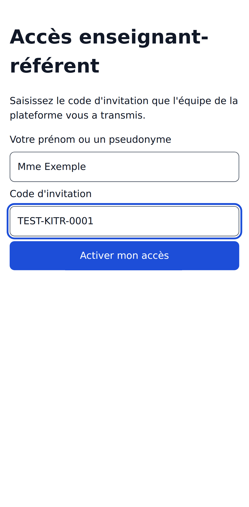
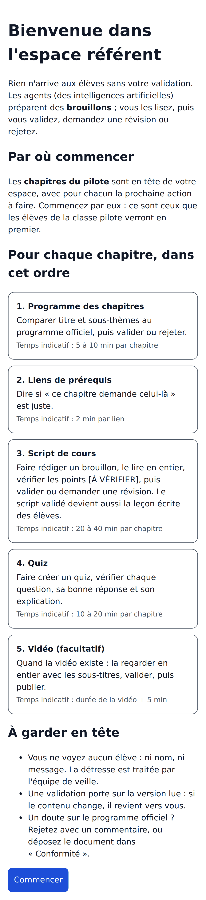
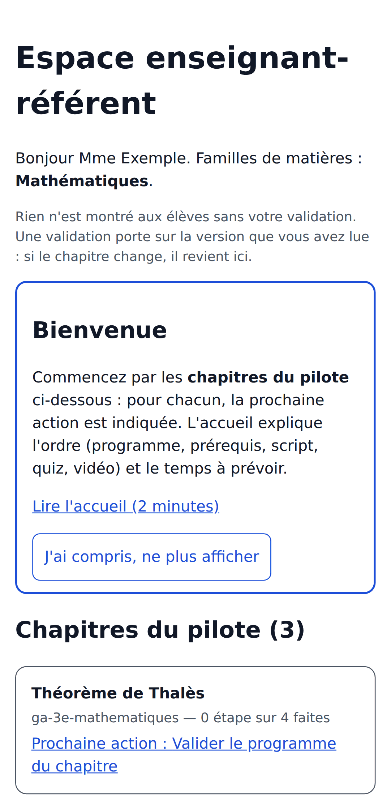
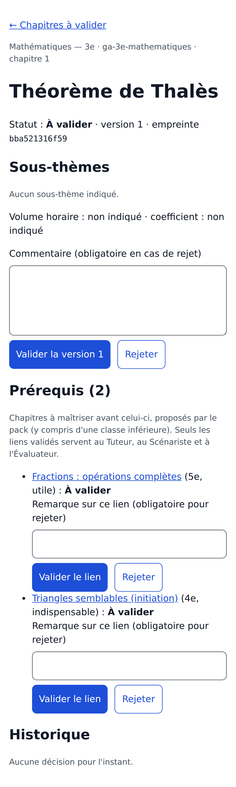
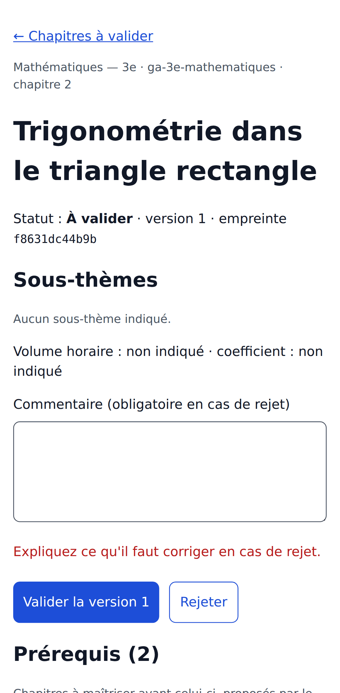
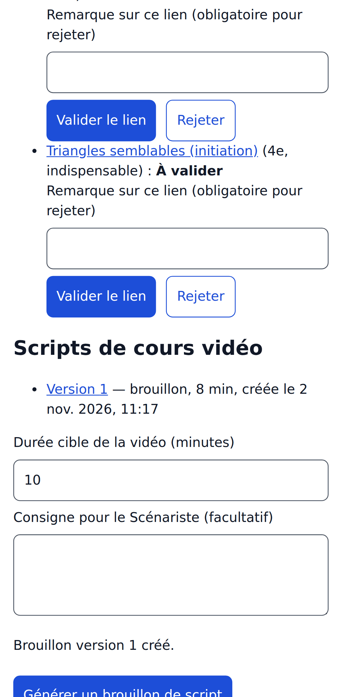
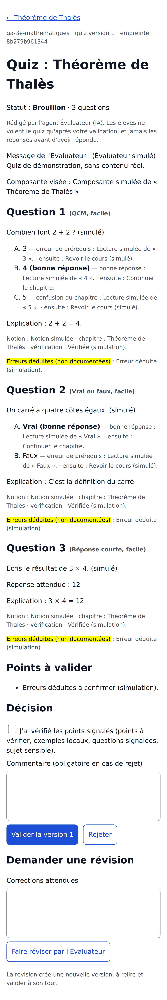
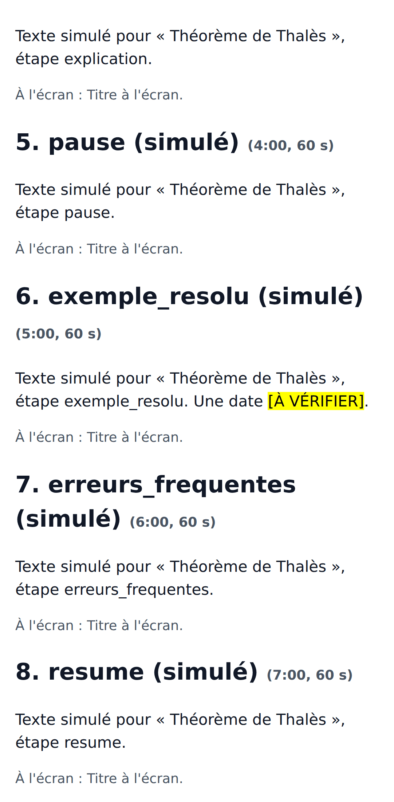
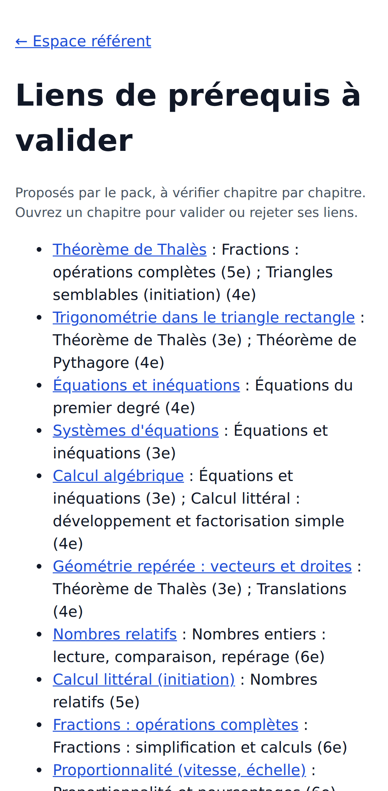
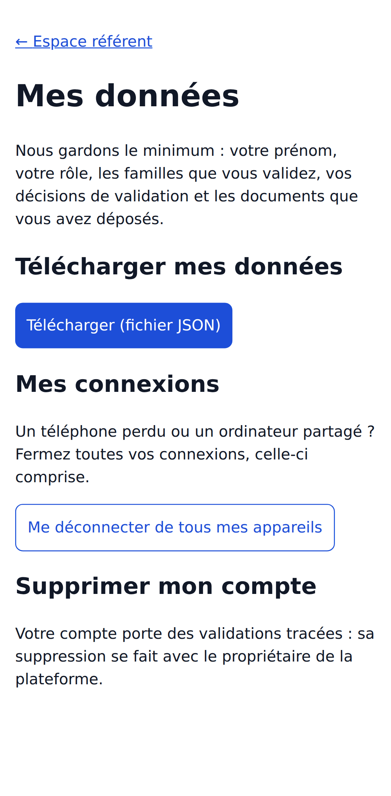

# Kit de démarrage du référent

**Pour qui** : l'enseignant-référent qui commence, et le propriétaire qui l'accueille. **Statut** : préparé par Claude Code (Jalon 19, étape 2), à relire par le propriétaire avant de le remettre.

Le kit compte trois documents :

| Document                                           | Pour qui                     | Quand                                              |
| -------------------------------------------------- | ---------------------------- | -------------------------------------------------- |
| [Aide-mémoire d'une page](aide-memoire.md)         | Le référent                  | À garder près de soi ; à imprimer                  |
| Guide pas à pas avec captures (ci-dessous)         | Le référent                  | À lire avant la séance, ou pendant                 |
| [Séance de prise en main](seance-prise-en-main.md) | Le propriétaire, qui la mène | Avant le premier vrai chapitre, environ 45 minutes |

Le [guide du référent](../guide-referent.md) reste la référence complète : rôle, règles, outils de conformité et de coordination, données personnelles.

## Guide pas à pas

Les captures montrent les vrais écrans, sur téléphone, avec des données **fictives**. Les textes marqués « (simulé) » viennent d'agents simulés. Avec le site réel, ce sont de vrais brouillons à relire.

### 1. Activer votre accès

Le propriétaire vous transmet un **code d'invitation** par un canal sûr. Connectez-vous avec votre numéro de téléphone (code reçu par SMS), ouvrez « Activer votre accès », puis saisissez votre prénom (ou un pseudonyme) et le code. Le code ne sert qu'une fois et n'est valable que quelques jours.

### 2. Lire l'accueil (2 minutes)

L'accueil explique l'ordre de travail et le temps à prévoir. On le retrouve à tout moment depuis l'espace référent.

### 3. Commencer par les chapitres du pilote

En tête de votre espace : les **chapitres du pilote**, choisis par le propriétaire. Pour chacun, la plateforme indique la **prochaine action** et l'avancement (étapes faites sur 4).

### 4. Relire un chapitre, puis valider ou rejeter

Vérifiez le titre, les sous-thèmes, le volume horaire et les prérequis par rapport au **programme officiel**. Puis :

- **Valider la version** : votre décision est tracée (votre prénom, la version, l'empreinte du contenu, la date) ;
- **Rejeter** : un commentaire est obligatoire et doit dire ce qu'il faut corriger.

Un rejet sans commentaire est refusé :

Si le chapitre change pendant votre lecture, la validation est refusée : relisez la nouvelle version.

### 5. Demander les brouillons de quiz et de script

Sur un chapitre **validé**, demandez un quiz brouillon (nombre de questions) et un brouillon de script (durée cible, consigne facultative). Ce sont des agents qui les rédigent ; rien n'est montré aux élèves.

### 6. Relire le quiz

Vérifiez chaque question, la bonne réponse et l'explication. Cochez la case de vérification, puis validez. Les élèves ne passent le quiz qu'**une fois** : une erreur coûte cher.

### 7. Relire le script, en commençant par les points [À VÉRIFIER]

L'agent marque en jaune ce qu'il n'a pas pu garantir : une date, un chiffre, un exemple local. Vérifiez chacun, puis validez ou **demandez une révision**. Le script validé devient aussi la **leçon écrite** que lisent les élèves, même sans vidéo et sans réseau.

### 8. Valider les liens de prérequis

« Ce chapitre demande celui-là » : chaque lien proposé se valide ou se rejette, avec une remarque. Ces liens guident le Tuteur quand un élève bloque.

### 9. Vos données

« Mes données » permet de télécharger tout ce que la plateforme garde sur vous, et de vous déconnecter de tous vos appareils si vous perdez votre téléphone.

---

Captures régénérables avec `cd application && pnpm demo:captures tests/demo/kit-referent.spec.ts`, puis `bash scripts/compresser-captures.sh ../docs/pilote/kit-referent/captures`.
